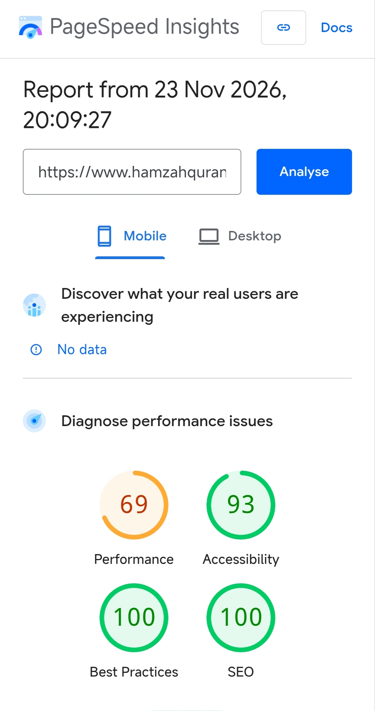

# Ringkasan Audit PageSpeed Insights (Lighthouse) — hamzahquran.com

## 1. Skor Kategori Utama

- **Performance (Performa)**: 69 (Mobile) / 61 (Desktop)
- **Accessibility (Aksesibilitas)**: 93
- **Best Practices**: 100
- **SEO**: 100

---

## 2. Metrik Performa Utama (Core Web Vitals & Loading)

- **First Contentful Paint (FCP)**: 2.3 detik pada seluler dan 0.6 detik pada desktop. (Waktu hingga konten/teks pertama muncul di layar).
- **Largest Contentful Paint (LCP)**: 33.5 detik pada seluler dan 4.5 detik pada desktop. (Metrik ini menjadi area paling kritis yang perlu diperbaiki, terutama pada perangkat seluler).
- **Speed Index (SI)**: 5.1 detik (Mobile) / 0.8 detik (Desktop).
- **Total Blocking Time (TBT)**: 30 ms (Mobile) / 380 ms (Desktop).
- **Cumulative Layout Shift (CLS)**: 0.007 (Mobile) / 0.001 (Desktop). (Sangat baik dan stabil, hampir tidak ada pergeseran tata letak yang mengganggu).

---

## 3. Diagnostik & Rekomendasi Optimasi Utama

### 1. Optimasi Pengiriman Gambar (Image Delivery)
- **Masalah**: Banyak gambar yang ukurannya jauh lebih besar daripada dimensi tampilannya di layar.
- **Potensi Penghematan**: Hingga 1,623 KiB di seluler dan 4,026 KiB di desktop.
- **Solusi**: Mengonversi gambar ke format modern seperti WebP/AVIF, meningkatkan kompresi, dan menggunakan *responsive images* (terutama untuk `hero-mobile.png`, `8qpp-a5.jpg`, dan `8qpp-a4.jpg`).

### 2. Permintaan yang Menghambat Rendisi (Render-Blocking Requests)
- **Masalah**: Berkas CSS dan Font eksternal memperlambat tampilan awal halaman.
- **Potensi Penghematan**: Mempercepat rendisi hingga 1,830 ms di seluler dan 390 ms di desktop.
- **Solusi**: Menunda (*defer*) pemuatan atau melakukan *inline* pada CSS kritis seperti Tailwind CDN (`cdn.tailwindcss.com`) dan Google Fonts.

### 3. Beban Jaringan Terlalu Besar (Enormous Network Payloads)
- **Masalah**: Total muatan jaringan mencapai 17.7 MB di seluler dan 17.0 MB di desktop.
- **Penyebab Utama**: Berkas video testimoni (`testi-hamzah1vid.mp4`) yang mengonsumsi transfer data hingga ~12.4 MB.

### 4. Pengurangan & Minifikasi JavaScript/CSS
- Pengurangan JavaScript yang tidak terpakai (*unused JS*) pada skrip pihak ketiga (seperti Facebook Pixel `fbevents.js`) dapat menghemat sekitar 131 KiB.
- Minifikasi skrip `script.js` (potensi hemat 9.6 KiB) dan `style.css` (potensi hemat 2.6 KiB).

### 5. Catatan Aksesibilitas (Skor 93)
- Terdapat tingkat kontras warna yang rendah (*low contrast ratio*) pada teks bagian footer (seperti tautan Shopee, Tokopedia, WhatsApp, dan teks hak cipta).
- Hirarki elemen judul (*heading order*) belum tersusun secara berurutan.

---
[Action Plan](action-plan_23-11.md) 
